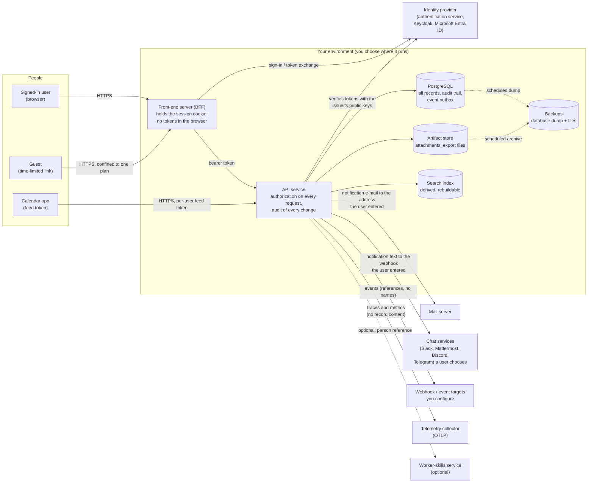

# Data-flow diagram

Where personal data comes from, where it is stored, and where it can leave.
"Personal data" here is mostly **opaque references to people** (see the
[inventory](personal-data-inventory.csv)): the service stores who led, owned,
was assigned, approved or acted, plus free text people type, not their names,
e-mail addresses or contact details.

## What crosses each boundary

| Flow | Personal data carried | Controls |
|---|---|---|
| Browser to front-end | Page requests; the session cookie | TLS (yours); `HttpOnly` session cookie; strict CSP; security headers; no third-party scripts, fonts or analytics load |
| Front-end to identity provider | The person signs in there; the service receives a verified subject and claims | OIDC authorization code with PKCE or the authentication service's magic link; tokens stay on the server |
| Front-end to API | A bearer token (subject, display name, attributes) per request | Short-lived token; verified offline against the issuer's public keys; login enforcement on by default |
| API to database | Everything in the [inventory](personal-data-inventory.csv) | Access only through the API; role-based and attribute-based access; private plans hidden from non-members; masking on export; each audit row carries integrity digests and, with a key, a MAC (an edited row is detected; a deleted row is not) |
| API to artifact store | Uploaded files (whatever people upload) | Type allow-list (no markup or executables), size cap, SHA-256 verified on download, `nosniff` and `attachment` on every download |
| API to mail server | The destination address **the user entered for their own notifications** (stored; see `notification_sinks.destination`), and the notification text | Your mail server's TLS; the user chooses the destination and can remove it; text carries titles and references, not record bodies |
| API to chat services | The notification text, to a chat webhook URL **the user entered** (Slack, Mattermost, Discord or Telegram) | These are third-party services outside your control and a transfer you must assess; disable the chat kinds if you do not want them (see Known limits); the destination is stored and is itself sensitive (a webhook URL is a bearer secret) |
| API to webhook targets | Events: the kind of change, the record's reference, the actor's reference | Targets are configured by the operator; loopback targets refused unless you allow them; deliveries logged; `OUTBOUND_STRICT=on` also refuses private and internal addresses |
| API to a virus scanner (optional) | The **whole bytes of every uploaded attachment**, to a `clamd` at `ATTACHMENT_SCAN_ADDR` | Off unless configured. Run the scanner inside your own network: the traffic is plain TCP with no encryption or authentication, and the files may contain personal data |
| API to telemetry collector | Spans and metrics: route, status, timing; no request or response bodies | Collector under your control; disable with `OTLP_ENDPOINT=""` |
| API to worker-skills service (optional) | One person reference per lookup | Off unless configured; the answer is never stored |
| Database / files to backups | A full copy of everything above | Encrypt backups at rest and in transit; retention is yours ([retention schedule](retention-schedule.md)) |
| Exports (JSON, CSV, PDF, calendar) | Whatever the caller is allowed to see | Same authorization as the screen; exports mask person references by default; a PDF is never more permissive than its JSON |

## What does not happen

- **No personal data is sent to the project's authors or to any analytics,
  advertising or error-reporting service.** The service makes no calls "home".
- **No third-party content loads in the application's pages** (the content
  security policy forbids it); the one icon font the widgets need is served from
  the same origin. The one exception is the API's own `/swagger-ui` documentation
  page, which loads its bundle from a public CDN; block that path at your proxy
  or do not expose it if that matters to you.
- **No data is used to train a model.** There is no model inside the service,
  and derived scores explain their inputs.

## Known limits

- **Notification destinations are user-chosen and stored.** An e-mail address
  is directly identifying. A chat webhook URL is a secret that lets anyone who
  holds it post to that channel. Both live in `notification_sinks.destination`
  and are protected only by the access policy and your database security.
  There is currently no operator switch to turn off the chat kinds; if you must
  forbid them, forbid outbound traffic to those services at your network edge.
